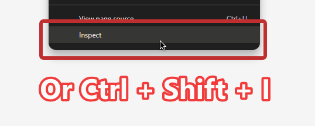
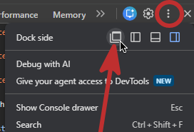
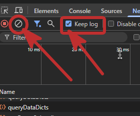
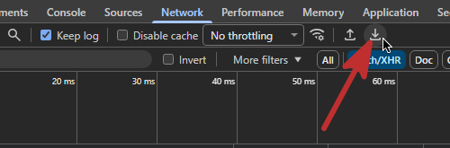
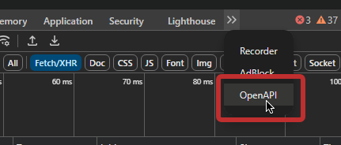
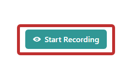
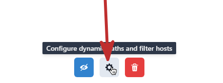
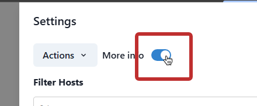
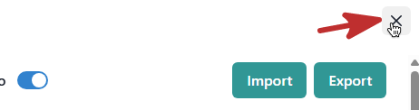
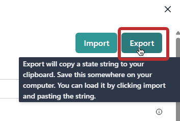

# Contributing

The most useful thing you can give Klue is a recording of your carrier's website.

Klue reads the same information your carrier's website shows you. To support a new kind of line, it needs to see what that website asks for and what it gets back while someone uses it. If you have a line Klue doesn't support yet (anything in the **Coming** column of [Supported lines](README.md#supported-lines)), about 20 minutes of your time can make it work for everyone with that line.

Recordings also help with lines Klue already supports when it shows something wrong, misses a bundle, or breaks after the carrier changes its site.

## What you'll send

Two recordings of the same walk-through of your carrier's website:

1. **A HAR file.** The browser's own record of every request the website makes.
2. **An OpenAPI file.** The same traffic, sorted into a tidy list by the OpenAPI DevTools extension, with an example value for each field.

You make both on a computer, in Chrome or another Chromium browser such as Edge or Brave. Then you remove your personal details from them and email them.

## Before you start

- **Have your carrier password ready.** Each recording has to include signing in.
- **Sign out of the carrier's website** if you're already signed in.
- **Sign in only once per recording.** Carriers lock accounts or block your connection after too many sign-ins: WE counts failed attempts, and Orange can block you for 15 to 30 minutes.
- **Don't buy, renew, pay for, or change anything.** Opening a page is enough. If a button leads to a confirmation screen, stop there and go back.

## The walk-through

You'll do this walk-through once in Part 1 and once in Part 2. The more of the site you open, the more Klue can show.

1. Sign in.
2. Open every page and tab you can find: usage, usage details, bundles, balance, bills, payment history, renewal, profile.
3. Press anything that shows more information: "Details", "More", "View all", expanding sections, month or date pickers.
4. If your account has more than one number, or more than one kind of line (mobile and home internet, say), use the website's line switcher to go back and forth between them a few times.
5. If the website has an Arabic/English switch, flip it once and look at a couple of pages in the other language.
6. Sign out. This also ends the session, so the sign-in codes left in the recording stop working.

## Part 1: Record the HAR file

1. Open your carrier's website. Don't sign in yet.

2. Open DevTools by pressing **Ctrl+Shift+I** (**Cmd+Option+I** on a Mac). If the website blocks the shortcut, right-click anywhere on the page and choose **Inspect**.

   

3. Move DevTools into its own window. DevTools usually opens inside the page, and some carrier websites notice the page suddenly getting narrower and lock themselves with "Console use prohibited". Click the **⋮** button at the top right of DevTools (next to **✕**), and under **Dock side** choose the first icon, **Undock into separate window**.

   

4. Go back to the carrier's page and refresh it (**F5**). The website may have spotted DevTools before you moved it.

5. In DevTools, open the **Network** tab. Tick **Preserve log**, so the list keeps going when the website changes pages. Then click **Clear** (🚫) to empty the list.

   

6. Do [the walk-through](#the-walk-through). Leave DevTools open the whole time; you'll see the list fill up.

7. When you've signed out, click the download arrow (**Export HAR**) in the Network tab's toolbar and save the file. A name like `we-mobile.har` helps.

   

## Part 2: Record the OpenAPI file

1. Install [OpenAPI DevTools](https://chromewebstore.google.com/detail/openapi-devtools/jelghndoknklgabjgaeppjhommkkmdii) from the Chrome Web Store, and check that it's turned on.

2. Open your carrier's sign-in page in a new tab. Make sure you're signed out.

3. Open DevTools, move it into its own window and refresh the page, as in [Part 1](#part-1-record-the-har-file), steps 2 to 4.

4. Open the **OpenAPI** tab in DevTools. If you can't see it, click **»** at the end of the tab row to show the rest.

   

5. Click **Start Recording**.

   

6. Before you do anything else, click the settings icon at the bottom, turn on **More info**, then close settings with the **✕** at the top right. With More info on, the file keeps an example value for each field instead of only saying whether it's text or a number.

   

   

   

7. Do [the walk-through](#the-walk-through) again.

8. Open settings again and click **Export**. The recording is copied to your clipboard.

   

9. Paste it into an empty text file and save it with a `.json` ending, for example `we-mobile-openapi.json`.

## Part 3: Remove your personal details

Both files hold everything the website showed you and everything you typed. Clean them before you send them.

1. Open each file in a text editor. Notepad works; VS Code or Notepad++ copes better with big files.

2. Use **Find** (**Ctrl+F**) and **Replace** (**Ctrl+H**) to replace every match of each of these:

   | Search for | Replace with |
   | --- | --- |
   | Your password | `PASSWORD` |
   | Your name: full name, then first and last name on their own | `NAME` |
   | Each phone and landline number, with and without the leading `0`, and with `20` or `+20` in front | `01000000000` (keep the same number of digits) |
   | Your national ID number | `00000000000000` |
   | Your email address | `user@example.com` |
   | Your home address | `ADDRESS` |
   | Account, customer or contract numbers, if the site shows any | zeros, same length |

3. Replace only the values. Leave the quotes, commas and brackets around them alone, or the file won't open.

4. Leave balances, quotas, bundle names, prices and dates as they are. That's what Klue needs to see.

Some websites scramble the password before sending it, so searching won't always find it. You signed out at the end, so the session in the file no longer works, but if you want to be completely safe, change your password after you've sent the files.

## Part 4: Send the files

Email both files to **[klue@wkar.im](mailto:klue@wkar.im)**. If they're large, zip them together first.

In the email, say:

- Your carrier and the kind of line, for example "WE mobile, prepaid" or "Vodafone home internet".
- The website address you recorded.
- Anything that looked odd or that Klue currently gets wrong for you.

Thank you. Every recording brings another kind of line closer.

## Contributing code

To build Klue and run its tests, see [docs/development.md](docs/development.md).
