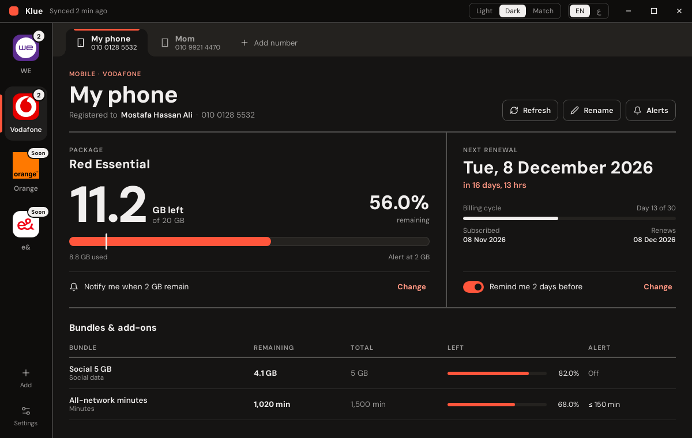
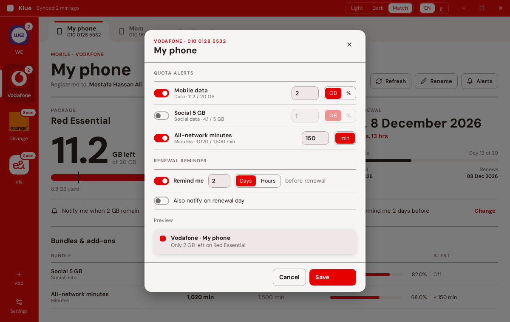
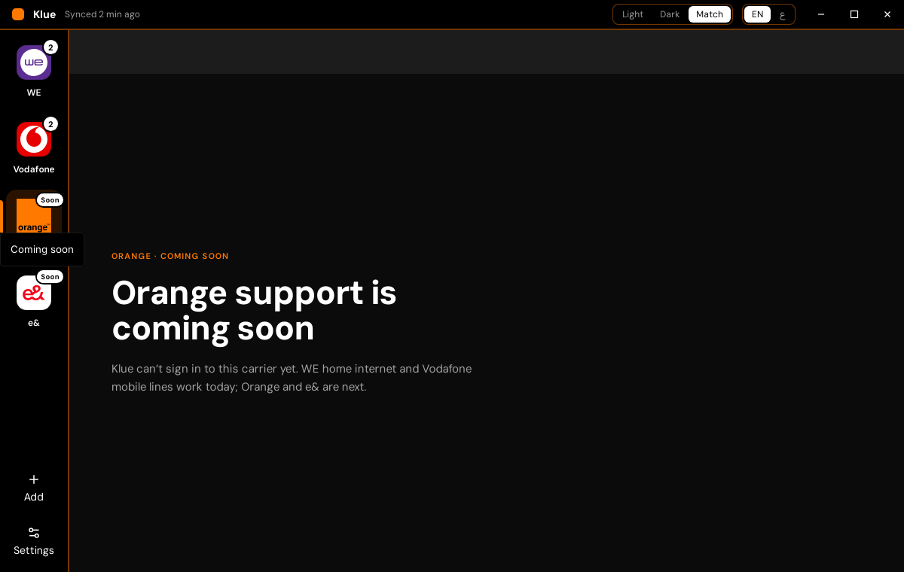

# Klue

A desktop app that puts the quota, package and renewal date of all your Egyptian telecom lines in one window. It's written in Rust: [Dioxus](https://dioxuslabs.com) for the UI, and the carrier sign-in flows were reverse-engineered.


| Carrier | Status |
| --- | --- |
| WE (Telecom Egypt) | Home internet (landline) |
| Vodafone | Mobile lines |
| Orange | Coming soon |
| e& | Coming soon |

## Features

- One tab per number, grouped by carrier. Each number shows its registered owner, an optional nickname, the package, GB left with percentages, the subscription date and the next renewal.
- Quota alerts at X GB or X% left, per bundle, and a renewal reminder X days or hours before renewal. Both arrive as desktop notifications.
- Adding a number signs in with the carrier's own password, checks it, and fills in the owner name from the account.
- Light, Dark and Match themes. Match recolors the app with each carrier's brand colors.
- English and Arabic, with a fully mirrored right-to-left layout. Fonts are DM Sans and Google Sans, bundled with the app.
- A tray icon with a quick-view popup. Optional launch at startup, minimized to the tray.
- Passwords live in the OS credential store (Windows Credential Manager, macOS Keychain or Secret Service), never in Klue's data file.

| | |
| --- | --- |
|  |  |
|  |  |
|  |  |

## Building

You need Rust 1.92 or newer plus a few native tools. `wreq` builds BoringSSL so that requests carry Chrome's TLS fingerprint.

- **Windows:** Visual Studio Build Tools (C++ workload), [CMake](https://cmake.org) and [LLVM](https://github.com/llvm/llvm-project/releases), which provides `libclang` for bindgen: `winget install Kitware.CMake LLVM.LLVM`. WebView2 is already part of Windows 10 and 11.
- **Linux:** `cmake clang pkg-config libssl-dev libwebkit2gtk-4.1-dev libxdo-dev libayatana-appindicator3-dev libdbus-1-dev`
- **macOS:** Xcode command line tools and `cmake`.

```sh
cargo run --release            # the app (binary: klue)
cargo run -- --demo            # sample numbers from the mockups, nothing saved, no network
cargo test -p klue-core --no-default-features
```

The default `ocr` feature downloads a prebuilt ONNX Runtime from cdn.pyke.io at build time and links it in. If you can't reach that host, build with `--no-default-features --features ocr-dynamic` and point `ORT_DYLIB_PATH` at an `onnxruntime.dll` or `libonnxruntime.so`. Klue also looks for that library next to the executable.

## WE captchas and ddddocr

After a few sign-ins, WE's `GenerateCaptcha` starts returning an image. When that happens, Klue reads the image with a Rust port of [ddddocr](https://github.com/sml2h3/ddddocr). It uses the same `common_old.onnx` model and the same preprocessing as `ddddocr.DdddOcr()` in Python, and keeps only letters and digits. If the OCR answer is rejected, the next manual **Refresh** (or **Try again** when adding a number) asks you to type the code yourself. If WE answers `Blocked`, Klue waits an hour before trying that number again.

1. Download the model. It is about 13 MB, taken from the ddddocr wheel on PyPI and checked against a SHA-256 hash:
   ```sh
   cargo run -p klue-core --example fetch_ocr_model            # into Klue's data folder
   cargo run -p klue-core --example fetch_ocr_model -- assets/models
   ```
2. Ask WE for captchas, save them, and see what ddddocr reads:
   ```sh
   cargo run -p klue-core --example we_captcha -- 0223584417 --count 5
   cargo run -p klue-core --example we_captcha -- 0223584417 --password '…'   # also signs in with the reading
   cargo run -p klue-core --example we_captcha -- --image captchas/a.jpg       # offline, on saved images
   ```
   `--unit-norm` switches to ddddocr 1.6's pixel scaling and `--raw` keeps the full charset, for comparison.

On 30 synthetic captchas (letters, digits and a strike-through line), 18 came back exactly right. Nearly every miss was an upper/lower-case slip on letters that look the same in both cases (`O/o`, `S/s`, `W/w`, `Z/z`), so 29 of 30 were right if case is ignored. WE's codes are case-sensitive, so check the real hit rate with `we_captcha --password`.

## Debugging the carrier parsers

The field names for the registrant name (WE) and the package name are not documented; the parsers try the likely names in order. To see what your account actually returns, run with `KLUE_DEBUG_DIR=debug`. Every carrier response is then written under `debug/`, with passwords, tokens and captcha images redacted. The parsers have fixtures in `crates/klue-core/tests/fixtures/`.

## Layout

```
crates/klue-core   carrier clients (WE, Vodafone), ddddocr, storage, alert rules; no UI
crates/klue-app    Dioxus desktop app: window, tray, notifications, launch at startup
design/            UI mockups
```

Data lives in `%APPDATA%\Klue\data\klue.json` on Windows, `~/.local/share/klue/` on Linux, and `~/Library/Application Support/Klue/` on macOS.

## Notices

Klue is unofficial and not affiliated with any carrier. Carrier names and logos belong to their owners. DM Sans and Google Sans are under the SIL Open Font License 1.1. The ddddocr model and charset are MIT-licensed (© sml2h3).
