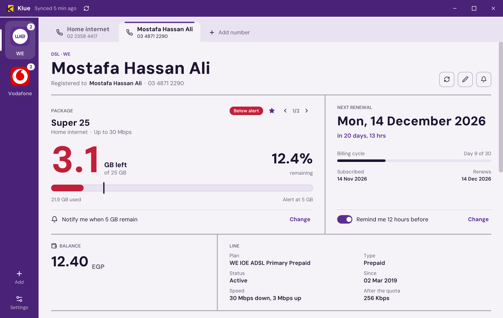
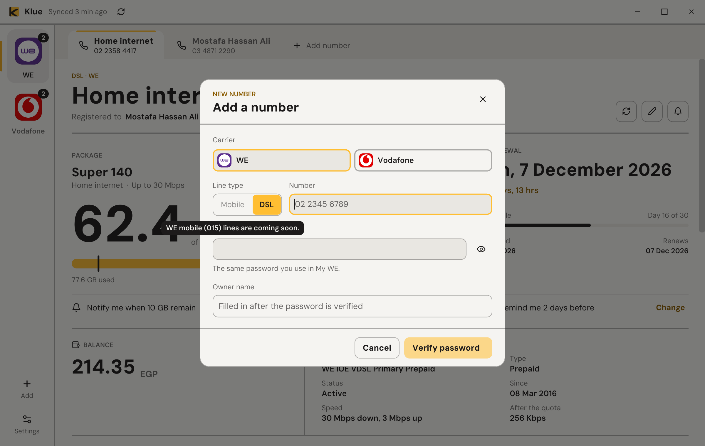
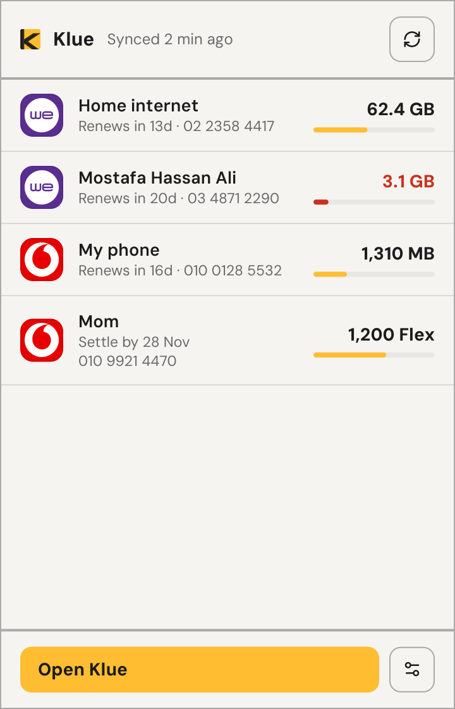

# Klue

A desktop app that puts the quota, package and renewal date of all your Egyptian telecom lines in one window. It's written in Rust: [iced](https://iced.rs) draws the UI natively on the CPU (no webview, no GPU stack), and the carrier sign-in flows were reverse-engineered.


| Carrier | Status |
| --- | --- |
| WE (Telecom Egypt) | Home internet (DSL) |
| Vodafone | Mobile lines |
| Orange | Coming soon |
| e& | Coming soon |

## Features

- One tab per number, grouped by carrier; only carriers you have numbers with are listed. Each number shows its registered owner, an optional nickname, the package, what's left in each bucket in the bucket's own unit (GB, MB, minutes, units), the subscription date and the next renewal.
- The balance in EGP, the line's plan, payment type and status, and the payment history (WE recharges and Vodafone payments).
- A Vodafone Flex bundle renewed on credit is marked borrowed, with the date to pay by before Vodafone freezes it, or frozen once it has; what the line owes shows under the balance.
- The main quota is the largest bucket that isn't empty. The arrows on the quota card step through the number's other buckets, and any of them can be made the main one with its star.
- WE lines show the package's speed (for example 30 Mbps down and 3 Mbps up) and the speed after the quota runs out, as WE's own site reports them.
- Usage graphs. Klue keeps what each bucket had left at every refresh and draws it, over what was used per day or per hour, with today's usage, the averages and the day the quota runs out at that rate. Refreshes come whenever they come (the computer sleeps, Klue is closed), so usage between two refreshes is spread over the time between them, and the graph shows where that was a long wait; renewals, top-ups and one-off bad readings don't throw it off. Hovering a refresh's dot gives its exact minute. Until there are enough refreshes for a graph, the averages are estimates from the cycle so far.
- Quota alerts at X GB or X% left, per bundle, and a renewal reminder X days or hours before renewal; Settings can set them for every number at once, and new numbers start with those. They arrive as desktop notifications with a sound (a warning tone for low quota, a softer one for the rest). Alerts that came due while Klue was closed or the computer slept arrive when it's back.
- Adding a number signs in with the carrier's own password, checks it, and fills in the owner name from the account.
- Light, Dark and Match themes, in Settings. Match recolors the app with each carrier's brand colors.
- English and Arabic, with a fully mirrored right-to-left layout. In Arabic, packages and plans carry the carrier's own Arabic names where it has them (WE's package names, Vodafone's plans and Flex); bundles the carriers only name in English stay in English. Fonts are DM Sans and Google Sans, bundled with the app.
- A tray icon with a quick-view popup that closes when you click elsewhere. Closing the window leaves Klue in the tray and frees the window's memory. Optional launch at startup, minimized to the tray.
- One Klue at a time: launching it again brings the running one forward.
- Updates: on launch Klue looks for a newer release on GitHub and shows what's new. It can download and install it: the Windows and Linux builds replace their own program file and restart, and a macOS disk image or a Linux package opens in the system's installer. Only releases built from the `main` branch count.
- On Windows, Klue adds itself to the Start menu (and to App Paths), so searching for it finds it, and its program file names Karim W. Almorsi as the publisher. Settings has an About section with the version and links.
- A disclaimer to accept on first launch and after each update: carriers don't offer these APIs to apps like Klue, and using one is at your own risk.
- Passwords live in the OS credential store (Windows Credential Manager, macOS Keychain or Secret Service), never in Klue's data file. Each is saved under the service `Klue` and the account `<carrier>:<number>` (for example `we:0223584417`), so any version of Klue finds it, and the list of your numbers is kept there too: an update or reinstall that starts with an empty data folder brings them back.

| | |
| --- | --- |
|  |  |
|  |  |
|  |  |
|  |  |
|  |  |

## Download

Builds for Windows, macOS (Apple Silicon and Intel) and Linux (`.deb` and `.tar.gz`) are on the [Releases](https://github.com/karimawi/Klue/releases) page. They aren't code-signed yet; the release notes explain how to open them the first time.

Klue draws its own title bar on every platform. On Windows and Linux the window is frameless; on macOS it keeps the native window shape and edges, with the system title bar made transparent and the traffic-light buttons over Klue's own title bar.

## Building

You need Rust 1.92 or newer plus a few native tools. `wreq` builds BoringSSL so that requests carry Chrome's TLS fingerprint.

- **Windows:** Visual Studio Build Tools (C++ workload), [CMake](https://cmake.org), [LLVM](https://github.com/llvm/llvm-project/releases), which provides `libclang` for bindgen, and [NASM](https://www.nasm.us): `winget install Kitware.CMake LLVM.LLVM NASM.NASM`.
- **Linux:** `cmake clang pkg-config`. No GUI development packages are needed: the X11, Wayland and xkbcommon libraries are loaded at run time (minimal installs may need `libxkbcommon-x11-0`), and the tray icon talks to the desktop over D-Bus.
- **macOS:** Xcode command line tools and `cmake`.

```sh
cargo run --release            # the app (binary: klue)
cargo run -- --demo            # sample numbers from the mockups, nothing saved, no network
cargo run -- --demo --quick-view   # start with the tray popup instead of the window
cargo run -- --minimized       # start in the tray (what "Launch at startup" uses)
cargo run -- --debug           # a console button in the title bar opens Klue's whole log
cargo test -p klue-core --no-default-features
```

## WE captchas

After a few sign-ins, WE's `GenerateCaptcha` starts returning an image: five red characters with a blue line struck through them. Klue reads it with its own model, trained only on this captcha (`tools/captcha-model`). It is a small CNN (0.4 M parameters, 1.7 MB), embedded in the app and run with [tract](https://github.com/sonos/tract), a pure-Rust ONNX runtime, so nothing is downloaded and no native ML library is needed.

The model also reports how sure it is, and below 0.95 it doesn't guess. A wrong code uses up one of the few sign-in attempts WE allows before blocking, but a new captcha costs nothing: each call to `GenerateCaptcha` replaces the previous one. So Klue asks WE for another captcha, up to 8 more times; on average a sign-in needs about 1.2. Only if the model can't read any of them does Klue ask you to type one, when you're adding a number or pressing **Refresh** (a background refresh just tries again later). If WE answers `Blocked`, Klue waits an hour before trying that number again.

Results on the 53 real captchas collected so far (`crates/klue-core/tests/captchas`; the model never trained on them):

| Reader | Exact | Ignoring case | Wrong answers it would submit |
| --- | --- | --- | --- |
| ddddocr (`common_old.onnx`) | 28/53 | 50/53 | 25 |
| Klue's WE model | **52/53** | 52/53 | **0** |

ddddocr reads the letters but guesses the case of `C O S V W X Z` (and, in the serif font, `Y`), which differ from their other case only in size. WE's codes are case-sensitive, and most 5-character codes contain at least one such letter. Klue's model sees the image at its real scale. Of the 53, it is sure enough to answer 46, all correctly; for the other 7 Klue would fetch a new captcha. One of those 7 it would have got wrong (`8HCs5`, read as `8HCsS`: in Times New Roman that `5` looks a lot like an `S`). On 3,000 fresh synthetic captchas it answers 85% of the time and is right 99.8% of the time when it does.

WE draws most captchas in Arial and about a third in Times New Roman (18 of the 53). Characters sit on a fixed 20 px pitch, so wide letters overlap their neighbours, the font size varies from one captcha to the next, and the text is drawn over the strike line.

The model never trained on these 53, but they did steer its training (they showed where the training captchas differed from WE's, and picked the better of two runs), so the next batch of real captchas is the honest test. If WE changes its generator, or the model starts declining often, collect more real captchas and fine-tune on them:

```sh
cargo run -p klue-core --example we_captcha -- <landline> --count 20            # saves fresh captchas to captchas/
cargo run -p klue-core --example we_captcha -- <landline> --password '…'        # also signs in; accepted codes land in captchas/labeled/
cargo run -p klue-core --example we_captcha -- --image captchas/a.jpg           # read saved images offline
```

Then follow `tools/captcha-model/README.md` to fine-tune. ddddocr is still available as an optional extra solver: build with `--features ocr` and fetch its model with `cargo run -p klue-core --example fetch_ocr_model`. That feature downloads ONNX Runtime from cdn.pyke.io at build time; `ocr-dynamic` loads it from `ORT_DYLIB_PATH` instead.

## Releasing

Bump `version` in the root `Cargo.toml`, then start `.github/workflows/release.yml` in either of two ways:

```sh
git tag v0.1.1 && git push origin v0.1.1
```

or use **Actions → Release → Run workflow** and pick `dev` (the tag is then `v` plus the `Cargo.toml` version; untick *Publish* to only build). GitHub only shows that button once the workflow file is on the default branch (`main`).

It builds `klue` on Windows, macOS (arm64 and x64) and Ubuntu 22.04, packages it with `packaging/package.sh` (zip, `.dmg` with `Klue.app`, `.deb` and `.tar.gz`) and attaches the files to a pre-release. If a build fails, the release stays a draft with that build's log attached. The version Klue reports (in About, and to the updater) is the tag's.

Klue's updater only offers releases whose commit is on `main`: a release made from `dev` is skipped. The first release from `main` is the first one users are offered.

## Debugging the carrier parsers

The field names for the registrant name (WE) and the package name are not documented; the parsers try the likely names in order. To see what your account actually returns, run with `KLUE_DEBUG_DIR=debug`. Every carrier response is then written under `debug/`, with passwords, tokens and captcha images redacted. The parsers have fixtures in `crates/klue-core/tests/fixtures/`.

## Layout

```
crates/klue-core     carrier clients (WE, Vodafone), captcha readers, storage, alert rules; no UI
crates/klue-app      iced desktop app: window, tray popup, notifications, single instance, launch at startup
tools/captcha-model  synthetic WE captcha generator and model training (Python, PyTorch)
tools/fonts          makes the bundled static TTFs from the variable fonts (fontTools)
tools/icons          renders the app and tray icons from icons/klue.svg
packaging/           release packaging (macOS bundle, Linux desktop entry, release notes)
design/              UI mockups
```

Data lives in `%APPDATA%\Klue\data\klue.json` on Windows, `~/.local/share/klue/` on Linux, and `~/Library/Application Support/Klue/` on macOS.

## Notices

Klue is unofficial and not affiliated with any carrier. Carrier names and logos belong to their owners. DM Sans and Google Sans are under the SIL Open Font License 1.1. The ddddocr model and charset are MIT-licensed (© sml2h3).
