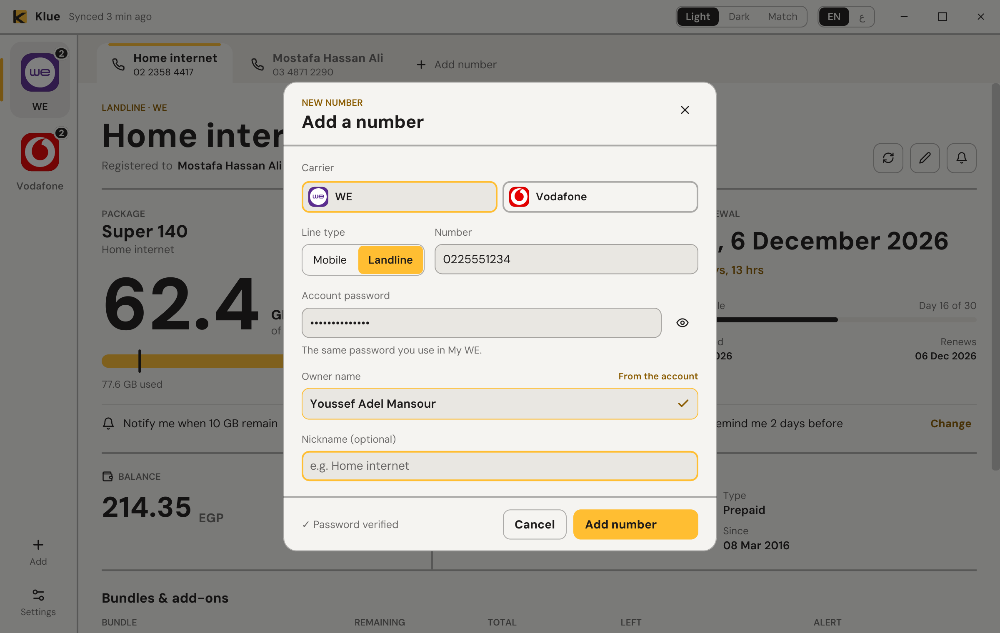

# Klue

A desktop app that puts the quota, package and renewal date of all your Egyptian telecom lines in one window. It's written in Rust: [Dioxus](https://dioxuslabs.com) for the UI, and the carrier sign-in flows were reverse-engineered.


| Carrier | Status |
| --- | --- |
| WE (Telecom Egypt) | Home internet (landline) |
| Vodafone | Mobile lines |
| Orange | Coming soon |
| e& | Coming soon |

## Features

- One tab per number, grouped by carrier. Each number shows its registered owner, an optional nickname, the package, GB left with percentages, the subscription date and the next renewal.
- Quota alerts at X GB or X% left, per bundle, and a renewal reminder X days or hours before renewal. Both arrive as desktop notifications.
- Adding a number signs in with the carrier's own password, checks it, and fills in the owner name from the account.
- Light, Dark and Match themes. Match recolors the app with each carrier's brand colors.
- English and Arabic, with a fully mirrored right-to-left layout. Fonts are DM Sans and Google Sans, bundled with the app.
- A tray icon with a quick-view popup. Optional launch at startup, minimized to the tray.
- Passwords live in the OS credential store (Windows Credential Manager, macOS Keychain or Secret Service), never in Klue's data file.

| | |
| --- | --- |
|  |  |
|  |  |
|  |  |

## Building

You need Rust 1.92 or newer plus a few native tools. `wreq` builds BoringSSL so that requests carry Chrome's TLS fingerprint.

- **Windows:** Visual Studio Build Tools (C++ workload), [CMake](https://cmake.org) and [LLVM](https://github.com/llvm/llvm-project/releases), which provides `libclang` for bindgen: `winget install Kitware.CMake LLVM.LLVM`. WebView2 is already part of Windows 10 and 11.
- **Linux:** `cmake clang pkg-config libssl-dev libwebkit2gtk-4.1-dev libxdo-dev libayatana-appindicator3-dev libdbus-1-dev`
- **macOS:** Xcode command line tools and `cmake`.

```sh
cargo run --release            # the app (binary: klue)
cargo run -- --demo            # sample numbers from the mockups, nothing saved, no network
cargo test -p klue-core --no-default-features
```

## WE captchas

After a few sign-ins, WE's `GenerateCaptcha` starts returning an image: five red characters with a blue line struck through them. Klue reads it with its own model, trained only on this captcha (`tools/captcha-model`). It is a small CNN (0.4 M parameters, 1.7 MB), embedded in the app and run with [tract](https://github.com/sonos/tract), a pure-Rust ONNX runtime, so nothing is downloaded and no native ML library is needed.

The model also reports how sure it is. Below 0.7 it doesn't guess, because every wrong answer uses up one of the few attempts WE allows before blocking sign-ins. Instead, Klue asks you to type the code when you're adding a number or pressing **Refresh**, and skips that attempt during background refreshes. If WE answers `Blocked`, Klue waits an hour before trying that number again.

Results on the five real captchas collected so far (`crates/klue-core/tests/captchas`):

| Reader | Exact | Ignoring case | Wrong answers it would submit |
| --- | --- | --- | --- |
| ddddocr (`common_old.onnx`) | 3/5 | 5/5 | 2 |
| Klue's WE model | 4/5 | 4/5 | **0** (declines the fifth) |

ddddocr reads the letters but guesses the case of `C O S V W X Z`, which in Arial differ only in size. WE's codes are case-sensitive, and most 5-character codes contain at least one of these letters. Klue's model sees the image at its real scale, so it gets `S7nQY`, `y6WWW` and `y7EZr` right. On 2,000 fresh synthetic captchas it answers 96.7% of the time and is right 98.3% of the time when it does.

Five real samples are enough to show the approach works, but not to prove reliability. The best next step is to collect a few hundred real captchas and fine-tune on them:

```sh
cargo run -p klue-core --example we_captcha -- 0223584417 --count 20            # saves fresh captchas to captchas/
cargo run -p klue-core --example we_captcha -- 0223584417 --password '…'        # also signs in; accepted codes land in captchas/labeled/
cargo run -p klue-core --example we_captcha -- --image captchas/a.jpg           # read saved images offline
```

Then follow `tools/captcha-model/README.md` to fine-tune. ddddocr is still available as an optional extra solver: build with `--features ocr` and fetch its model with `cargo run -p klue-core --example fetch_ocr_model`. That feature downloads ONNX Runtime from cdn.pyke.io at build time; `ocr-dynamic` loads it from `ORT_DYLIB_PATH` instead.

## Debugging the carrier parsers

The field names for the registrant name (WE) and the package name are not documented; the parsers try the likely names in order. To see what your account actually returns, run with `KLUE_DEBUG_DIR=debug`. Every carrier response is then written under `debug/`, with passwords, tokens and captcha images redacted. The parsers have fixtures in `crates/klue-core/tests/fixtures/`.

## Layout

```
crates/klue-core     carrier clients (WE, Vodafone), captcha readers, storage, alert rules; no UI
crates/klue-app      Dioxus desktop app: window, tray, notifications, launch at startup
tools/captcha-model  synthetic WE captcha generator and model training (Python, PyTorch)
design/              UI mockups
```

Data lives in `%APPDATA%\Klue\data\klue.json` on Windows, `~/.local/share/klue/` on Linux, and `~/Library/Application Support/Klue/` on macOS.

## Notices

Klue is unofficial and not affiliated with any carrier. Carrier names and logos belong to their owners. DM Sans and Google Sans are under the SIL Open Font License 1.1. The ddddocr model and charset are MIT-licensed (© sml2h3).
