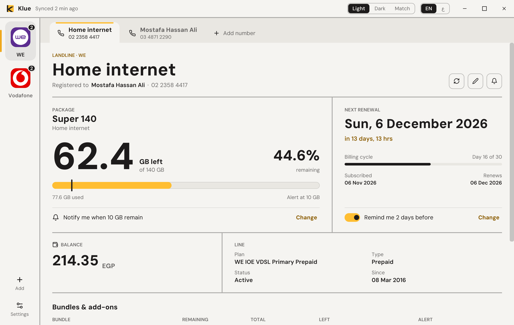
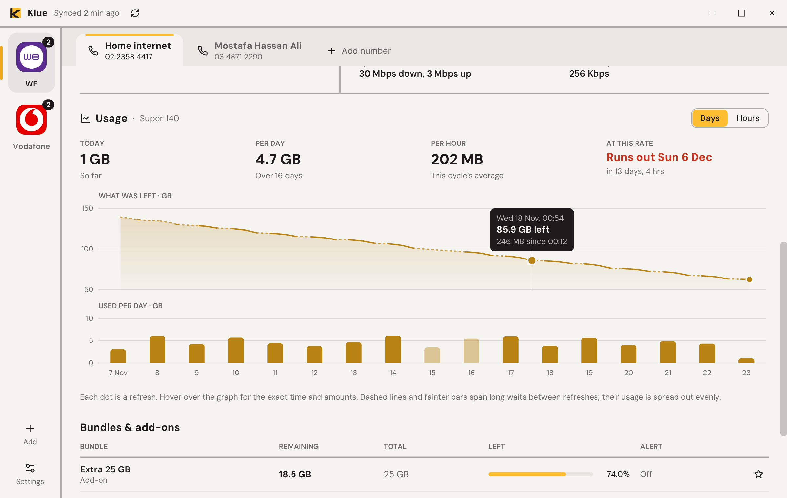
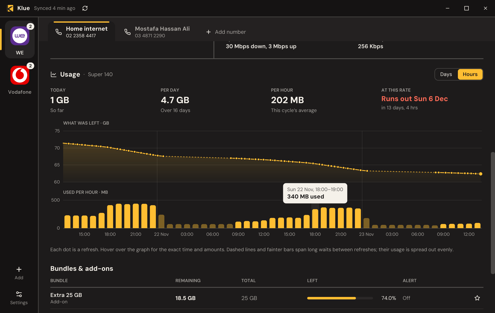
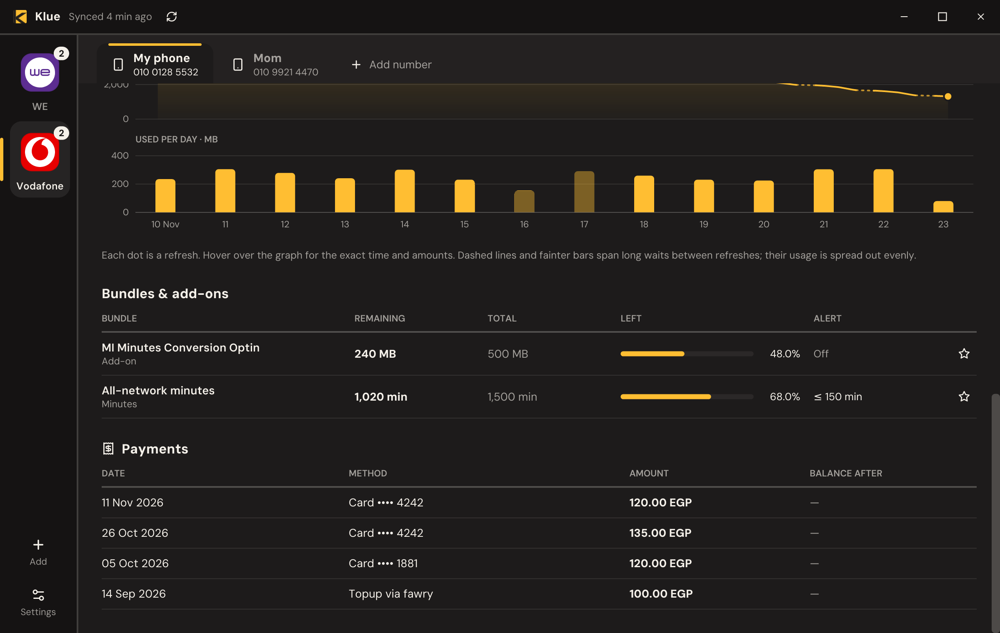

<p align="center">
  
</p>

<h1 align="center">Klue</h1>

<p align="center">
  Your Egyptian telecom lines in one window: quota, balance, renewals and usage.
</p>

<p align="center">
  <a href="https://github.com/karimawi/Klue/releases" target="_blank">
    
  </a>
  <a href="https://github.com/karimawi/Klue/releases" target="_blank">
    
  </a>
  <a href="#download" target="_blank">
    
  </a>
  <a href="LICENSE" target="_blank">
    
  </a>
</p>

<p align="center">
  <a href="https://klue.wkar.im">Website</a> ·
  <a href="https://github.com/karimawi/Klue/releases">Download</a> ·
  <a href="#build-from-source">Build from source</a>
</p>

<p align="center">
  
</p>

## Features

- **Every line at a glance.** What's left, the package and its speed, the balance, the renewal date and the payment history, for each of your numbers.
- **Usage graphs.** What was left after every refresh and what you used per day or per hour, with averages and the day you'll run out.
- **Alerts that land.** Low-quota and renewal notifications with sound, per number or for all of them, even ones that came due while Klue was closed.
- **Arabic and English.** A fully mirrored right-to-left layout, using the carriers' own Arabic names.
- **Light, Dark and Match.** Match dresses the app in each carrier's colours.
- **Stays out of the way.** A tray quick view of every number, launch at startup, built-in updates.
- **Private.** Passwords stay in your system's credential store. Klue talks to your carrier and nothing else (apart from GitHub, to check for updates).

## Supported lines

| Carrier | Works today | Coming |
| --- | --- | --- |
| WE | Home internet (DSL) | Mobile, OneHome, Gold, Ardy |
| Vodafone | Mobile | DSL, USB |
| Orange | | DSL, Mobile |
| e& | | DSL, Mobile |

Also on the way: Klue Server, a Docker container that keeps watch around the clock on your own VPS, linked to the app with a key, with a Telegram bot and phone widgets.

## Screenshots

| | |
| --- | --- |
|  |  |
|  |  |
|  |  |
|  |  |
|  |  |

## Download

Grab the latest build for Windows, macOS (Apple Silicon and Intel) or Linux (`.deb` and `.tar.gz`) from [Releases](https://github.com/karimawi/Klue/releases). The builds aren't code-signed yet; the release notes show how to open them the first time.

## Build from source

You need Rust 1.92 or newer with CMake and Clang (and NASM and LLVM on Windows).

```sh
cargo run --release      # the app
cargo run -- --demo      # try it with made-up numbers
cargo test -p klue-core --no-default-features
```

More in [docs/development.md](docs/development.md).

## License

[GPL-3.0](LICENSE). Klue is unofficial and isn't affiliated with WE, Vodafone, Orange or e&; their names and logos belong to them. DM Sans and Google Sans are under the SIL Open Font License, and the optional ddddocr model is MIT-licensed (© sml2h3).
